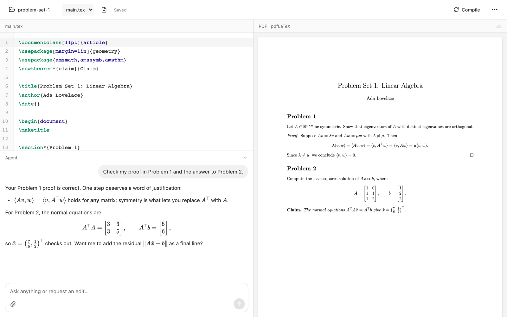

# Paperdesk

[](https://github.com/michael-L-i/paperdesk/actions/workflows/ci.yml)

**A local LaTeX editor with a live PDF preview and an AI agent that can read your whole project.**

Write LaTeX on the left and see the PDF on the right. Ask the agent to explain a problem set, convert a PDF to LaTeX, or edit your document. The agent runs on the [Codex CLI](https://github.com/openai/codex). Everything runs on your machine, using your own TeX Live install and Codex login.



## Features

- **Live preview.** Edits autosave and compile when you pause typing. The PDF updates without losing your scroll position.
- **Any engine.** Builds use `latexmk` with pdfLaTeX, XeLaTeX, or LuaLaTeX, picked per document. BibTeX, biber, and reruns happen automatically.
- **SyncTeX.** Double-click the PDF to jump to the matching source line.
- **An agent that sees your folder.** It reads PDFs, notes, and code itself, knows which PDF is built from which `.tex`, and remembers the conversation.
- **Safe edits.** The agent can read your files but not modify them. Paperdesk applies the agent's edits all at once, with revision checks and history snapshots.
- **A readable chat.** Replies render Markdown and KaTeX math. Attach files with the paperclip, paste, or drag and drop.
- **Your writing style.** Your own edits become examples the agent follows. This is prompt memory, not model training.

## Requirements

- macOS (the folder picker uses the native dialog)
- Node 22+
- TeX Live and Poppler
- [Codex CLI](https://github.com/openai/codex), signed in (only needed for the agent)

```sh
brew install node texlive biber poppler
npm install -g @openai/codex && codex login
```

MacTeX works in place of the `texlive` formula.

## Quick start

```sh
git clone https://github.com/michael-L-i/paperdesk.git
cd paperdesk
npm install
npm run build
npm start
```

Open http://localhost:4317 to see your projects. Click **New project**, then:

- **Blank project** creates a folder in your Paperdesk library (`~/Documents/Paperdesk`).
- **Open folder…** links a folder you already have, such as one with a `.tex` file or just a PDF you want converted.

Paperdesk only reads and writes inside your projects' folders. Removing a linked project only takes it off the list. Deleting a library project moves its folder to the Trash. On macOS you can also double-click **Start Paperdesk.command**.

## Usage

| To | Do this |
|---|---|
| Compile now | Click **Compile**, or press ⌘/Ctrl Enter outside the chat |
| Turn auto-compile on or off | **More → Auto-compile** |
| Jump from the PDF to the source | Double-click the PDF |
| Force an engine | Put `% !TEX program = xelatex` (or `pdflatex`, `lualatex`) at the top of the file |
| Change the main document | Click the star next to a `.tex` file in **Files** |
| Add images or other files | Drag them onto **Files**, or click the upload button |
| Preview, download, rename, or delete an image | Click it in **Files** (PDFs preview too; deleted files go to the Trash) |
| Send a chat message / add a line | Enter / Shift Enter |
| Stop the agent | Click the stop button that replaces send while it works |
| Restore an earlier save | **More → History** |
| Edit your writing profile | **More → Writing style** |

The main document is the file that compiles and appears in the PDF pane. Opening a `.tex` file with `\documentclass` makes it the main document. Opening a chapter, a `.bib`, or another fragment keeps the current one. A `% !TEX root = ../main.tex` line in a fragment names its main document.

Without a magic comment, Paperdesk picks the engine from the preamble:

- `fontspec`, `unicode-math`, `polyglossia`, or `\setmainfont` → XeLaTeX
- `luacode` or `\directlua` → LuaLaTeX
- anything else → pdfLaTeX

If the log shows the document needs a different engine, the build retries once with it. A failed build keeps the previous PDF and shows the first TeX error. Unsaved drafts survive a reload. If a file changes outside Paperdesk, you get a conflict warning instead of an overwrite.

## How the agent works

Each request runs `codex exec` in a scratch folder with the `workspace-write` sandbox. The agent can read your project and run commands such as `pdftotext`, `pdftoppm`, and `latexmk`, but it can't modify your files. It returns a message, plus the complete new contents of each file it changes, such as a chapter and `refs.bib`. Paperdesk checks every file for changes made while the agent worked, then saves them all with history snapshots, or saves none. The agent's standing instructions are in [`.agents/skills/paperdesk/SKILL.md`](.agents/skills/paperdesk/SKILL.md).

Each request sends the open document, the conversation, your writing profile, and any files the agent reads to your Codex provider.

## Configuration

| Variable | Default | Purpose |
|---|---|---|
| `PAPERDESK_LIBRARY` | `~/Documents/Paperdesk` | Where new projects are created |
| `PORT` | `4317` | Server port (listens on 127.0.0.1 only) |
| `CODEX_BIN` | `codex` | Codex CLI executable |
| `PAPERDESK_DATA_DIR` | `.data` | Project list, writing profile, edit examples, and uploads |

Each document folder keeps its save history in `.paperdesk/history/` (the last 80 versions).

## Development

```sh
npm run dev            # UI served through Vite; restart after server changes
npm test               # unit tests (need TeX Live and Poppler)
npm run test:browser   # end-to-end tests in Chrome (set CHROME_BIN to override)
npm run test:ai        # live check that uses your Codex account
```

See [CONTRIBUTING.md](CONTRIBUTING.md) to get involved, and [SECURITY.md](SECURITY.md) to report a vulnerability.

## License

[MIT](LICENSE)
